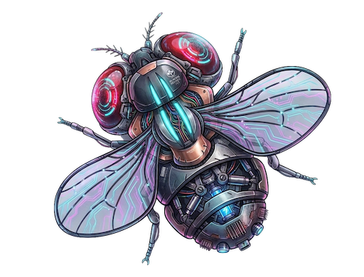
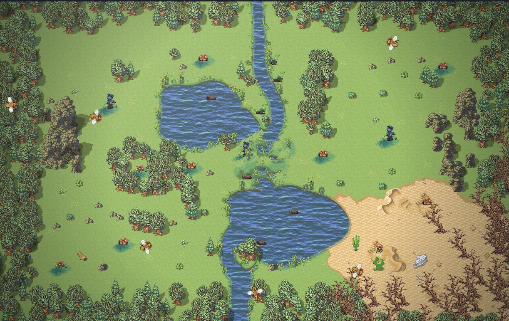
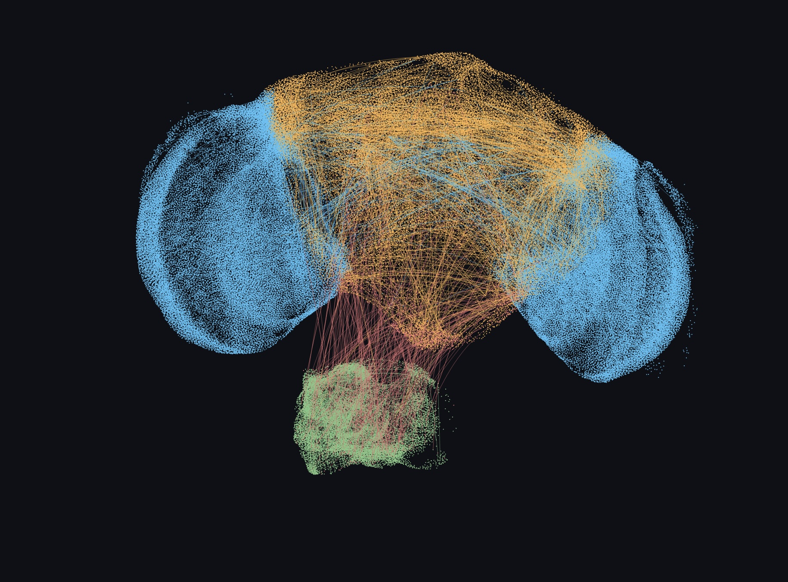

<p align="center">
  
  <h1 align="center">microfly</h1>
  <p align="center"><strong>Real fruit fly connectomes in a tiny arcade world.</strong><br/>
  Spiking brains cut from the male <em>Drosophila</em> CNS, each fly running its own brain in your browser.</p>
</p>

<br/>
<br/>

<table>
  <tr>
    <td width="50%" align="center"></td>
    <td width="50%" align="center"></td>
  </tr>
  <tr>
    <td align="center"><sub>The world: flies, flowers, dangers and the live fly panel</sub></td>
    <td align="center"><sub>The brain inspector: an extracted connectome in 3D</sub></td>
  </tr>
</table>

---

## Quick start

The app is plain HTML, CSS and ES modules. There is no build step and nothing to install for the browser. Any static web server works.

### (a) The world with the latest brain (demo forager)

```bash
cd public
python3 -m http.server 8000
```

Open <http://localhost:8000/>.

Six hungry flies run the 14,500-neuron brain. They smell flowers, walk to them and eat. They escape the danger in the forest, and they leave once they are fed. Food runs out as it is eaten and grows back. Pick a fly in the **world** tab. The **fly** tab then shows its action, energy, neuron activity, its **twelve input** and **six output** channels, and the **decoded readout**: for each sense, which side the stimulus is on, how strong it is, how it is changing, and the sense's declared valence. In the world tab you can switch the food-odour, danger-odour, heat and tile-grid layers on and off.

Other worlds on the same server:

| URL                                                  | Brain                                                                                  |
| ---------------------------------------------------- | -------------------------------------------------------------------------------------- |
| `/`                                                  | `v3`: demo forager, the wide-I/O brain with a decoded readout and body layer (default) |
| `/?world=world/world-forager-social.json`            | `v3`: social brain (ADR 012) — every fly also smells and touches the others            |
| `/?world=world/world-forager-wide.json`              | `v2`: wide-I/O brain (14,500 neurons) read through its six named output neurons        |
| `/?world=world/world-forager-11k.json`               | `v1`: class-seeded forager brain (11,000 neurons)                                      |
| `/?world=world/world-forager.json`                   | `v1`: hungry forager brain (~3,400 neurons)                                            |
| `/?world=world/world-forager-food-feeding-demo.json` | `v1`: hungry forager with hunger-sensitive smell and food that runs out (spec 018)     |
| `/?world=world/world-antennal-lobe.json`             | `v0`: antennal-lobe brain (35 neurons)                                                 |
| `/?world=world/world-connectome.json`                | `v0`: smallest functional brain (11 neurons)                                           |
| `/?world=world/world.json`                           | `mock`: random toy network                                                             |

### (b) Brain inspector

With the same server running, open <http://localhost:8000/brains/>.

The inspector loads the `.brain` snapshots listed in [public/brains/brains.json](public/brains/brains.json) and draws each neuron at its real soma position, with its edges. Use the selector to switch between brains, group neurons by annotation level, toggle connections, and hover a neuron to see its identity.

### (c) MaleCNS inspector

[inspector/malecns-3d.html](inspector/malecns-3d.html) is a self-contained 3D view of the whole male CNS dataset. Open it directly in a browser:

```bash
open inspector/malecns-3d.html          # macOS; or double-click the file
```

### Tests and experiments

Requires Node 20+.

```bash
npm test                                 # unit and contract tests
npm run test:slow                        # long-running behaviour tests
node --test public/tests/*.test.js       # world generation tests
node scripts/compare-baseline.mjs --world=world/world-forager.json --seeds=held-out
```

Brains are calibrated with the deterministic CLI of the `microfly-calibrate` skill. The demo forager uses one command (ADR 010 Part H):

```bash
node .claude/skills/microfly-calibrate/scripts/calibrate.mjs --version=demo-v3 --stage=all --budget-minutes=30
```

---

## Inspiration

Janelia, Google Research and collaborators have mapped the complete central nervous system of a male fruit fly from electron microscopy: brain *and* ventral nerve cord, over 200,000 reconstructed bodies and hundreds of millions of synapses. Google's post [A connectomics milestone: Mapping the complete male fruit fly brain](https://research.google/blog/a-connectomics-milestone-mapping-the-complete-male-fruit-fly-brain/) tells the story.

microfly asks a simple question: **if you cut a small piece out of that wiring diagram and run it as a spiking network, does the fly do anything useful?**

*- Spoiler: Yes, it’s confirmed… but there’s more to it.*

[malecns.md](malecns.md) is the project's field guide to the dataset (release v1.0, `minconf-0.5`). It covers:

- the 11 Feather files: 211,577 annotated bodies, ~312M synapses in total, ~124M between fully traced neurons;
- the annotation schema: `superclass`, `class`, `type`, `somaSide`, `rootSide`, reconstruction `status`;
- connectivity: edge `weight` is a synapse count, and predicted neurotransmitters give each neuron a sign;
- caveats, and a catalogue of neuron types and what they do.

The dataset itself (~29 GB) is not committed. The extractor reads it from `data/malecns/` or `MALECNS_DIR`.

Obtain the dataset from https://male-cns.janelia.org/download/

---

## Brain v2: from four senses to a fly that forages and escapes

Brain v2 grew the 11K class-seeded brain into a fly that smells, tastes, touches, finds food, eats and escapes danger. It is described in [ADR 007](adrs/007-wide-io-forager-brain.md) to [ADR 010](adrs/010-demo-forager.md).

- **Six senses** ([ADR 007](adrs/007-wide-io-forager-brain.md)). Food odour, danger odour, heat, mouth taste, leg taste and touch, each left and right, plus six outputs including escape. All of them are declared in data.
- **A complete readout path** ([ADR 009](adrs/009-output-partner-seeds.md)). The brain now keeps the neurons that feed its outputs. At 14,500 neurons it carries 92 % of the connectome's food steering signal, up from 14 %.
- **A working demo** ([ADR 010](adrs/010-demo-forager.md)). The brain decides which side a stimulus is on, how strong it is, when to feed and when to escape. A declared body layer, standing in for the nerve cord, turns those decisions into walking.
- **A lesson on the way** ([ADR 008](adrs/008-steering-regime.md)). Tuning LIF parameters alone could not make the brain steer, because a silent brain passes no graded signal.

**What this achieves:** flies driven by the brain find food more often than flies that wander at random, and spend about a third or less of the time near danger.

| Map     | Finds food (higher is better): brain / random walk | Time near danger (lower is better): brain / random walk |
| ------- | -------------------------------------------------- | ------------------------------------------------------- |
| sketch  | 83 % / 56 %                                        | 21 % / 62 %                                             |
| tilemap | 50 % / 39 %                                        | 10 % / 66 %                                             |

How to read it:

- **Brain** is the demo forager. **Random walk** is the same body with the brain's signals switched off. The gap between the two numbers is what the brain adds.
- **Finds food** is the share of hungry flies that reach a flower within 75 seconds.
- **Time near danger** is the share of time a fly spends near the forest edge, where danger odour is.
- Each number comes from 18 flies on the seeds used for tuning. The danger gap is large and clear. The food gap is promising but needs confirming on unseen seeds.

Open findings: the held-out and random-graph runs are still to do, and heat avoidance is weaker than the random walk's. Details are in [specs/017-demo-forager/](specs/017-demo-forager/).

---

## How the app works

```text
 world (main thread)                                  fly brain (one Web Worker per fly)
 ┌──────────────────────────────┐   sense            ┌────────────────────────────────────┐
 │ map: flowers, forest edge,   │ ─────────────────► │ 12 input pools (food, danger, heat,│
 │ water, solid objects         │  inputs[], hunger  │   mouth taste, leg taste, touch)   │
 │ fields: food, danger, heat   │                    │              │                     │
 │ body: energy, hunger, sites  │                    │ LIF network, 14,500 connectome     │
 │                              │ ◄───────────────── │   neurons, 730,859 edges           │
 │ decoder → body layer → motor │   spikes, outputs  │ 6 named output pools               │
 └──────────────────────────────┘                    └────────────────────────────────────┘
```

1. Each tick (20 Hz) the world measures what each fly senses at the body site each channel declares: odour and heat at the antennae, taste at the mouth and front legs, touch at the front legs. It sends these to the fly's worker with the fly's hunger.
2. The worker drives the brain's input neurons, runs the LIF network for 5 steps, and returns the spikes and the output pool rates.
3. For a `v3` brain, the decoder turns spikes into per-sense side, drive and trend signals. The body layer turns these into heading and speed, and the motor stage carries them out within turn and acceleration limits. Older brains map their named output pools directly to walking, turning and feeding.
4. A fly eats only when it stands in a flower's eating area and the brain's feed signal is above threshold. Each flower holds one, two or three meals by size. Its odour fades as it is eaten, and it recovers after 30 seconds.

All neural computation is off the main thread, and every run is reproducible from a seed.

### Brains

Select a brain with `flies.brain` in the world config (see [public/world/README.md](public/world/README.md)).

| Brain                         | Version | Size                                | What it is                                                                                                                                                                                                                                                                                                                                                                                             |
| ----------------------------- | ------- | ----------------------------------- | ------------------------------------------------------------------------------------------------------------------------------------------------------------------------------------------------------------------------------------------------------------------------------------------------------------------------------------------------------------------------------------------------------ |
| **Mock**                      | `mock`  | 40 neurons                          | A seeded random graph with excitatory and inhibitory neurons. One odour input, left and right motor outputs. A test fixture that checks the LIF core and the worker plumbing before real data is involved ([ADR 001](adrs/001-lif-toy-network-and-fly-integration.md)).                                                                                                                                |
| **Smallest functional brain** | `v0`    | 11 neurons                          | The smallest real subgraph that can drive a fly: one olfactory projection neuron (ALPN) → interneurons → a left and a right descending neuron. Every neuron is a traced body from the dataset ([ADR 002](adrs/002-smallest-functional-brain.md)).                                                                                                                                                      |
| **Antennal-lobe brain**       | `v0`    | 35 neurons                          | Same idea with olfactory receptor neurons (ORN) as the entry point, tuned as the best single-input brain. It finds flowers by looping, not by following the odour. Kept as a comparison arm.                                                                                                                                                                                                           |
| **Hungry forager**            | `v1`    | ~3,400 neurons, ~205K connections   | Bilateral smell and taste pools feed about 2,600 interneurons ranked by information flow. Outputs are the real steering (DNa01, DNa02), forward (DNp09), backward (MDN) and feeding (MN9) neurons. Hunger raises the gain of smell and taste ([ADR 003](adrs/003-hungry-forager-brain.md), [ADR 004](adrs/004-output-pool-synaptic-scale.md), [ADR 005](adrs/005-dynamical-regime.md)).                |
| **Class-seeded forager**      | `v1`    | 11,000 neurons, ~448K connections   | The same six channels, but the interneurons are whole functional classes (every antennal-lobe PN/LN, every Kenyon cell, MBON, DAN, every descending neuron) plus ~2,900 more by shared connectivity, not ranked by flow. An extraction-fidelity probe checks the brain still carries the connectome's steering and feeding routes before it ships ([ADR 006](adrs/006-class-seeded-forager-brain.md)). |
| **Wide-I/O forager**          | `v2`    | 14,500 neurons, 730,859 connections | The class-seeded topology rule plus every presynaptic partner of the output pools as a seed ([ADR 009](adrs/009-output-partner-seeds.md)), with twelve bilateral senses and six outputs ([ADR 007](adrs/007-wide-io-forager-brain.md)). Read through its six named output neurons; escape physics is off.                                                                                              |
| **Demo forager**              | `v3`    | same snapshot as `v2`               | The wide-I/O brain with a decoded population readout, online homeostasis, a hunger threshold on food senses, a tonic background current and a declared body layer with escape on ([ADR 010](adrs/010-demo-forager.md)). The default world.                                                                                                                                                             |


## The core algorithm: a leaky integrate-and-fire network

The connectome tells us *who is wired to whom*. To get behaviour out of it, something has to make signals flow through that wiring. In microfly that something is a network of **leaky integrate-and-fire (LIF)** neurons: one LIF neuron per connectome neuron, one weighted connection per connectome edge.

### Why LIF

- **It needs only what the connectome provides.** The dataset gives, for each pair of neurons, a synapse count and a predicted neurotransmitter. It does not give ion channels, dendrite shapes or membrane constants. A LIF neuron needs exactly one number per connection (a signed weight) and a handful of shared constants. More detailed models, such as Hodgkin–Huxley, would need parameters the data does not have, and we would be guessing them for thousands of neurons.
- **Spikes and thresholds matter.** Real neurons are silent until their input crosses a threshold, then fire all-or-nothing, then rest. That non-linearity is what lets a circuit ignore weak noise, pick a side, or switch between walking and feeding. A smooth rate model loses it.
- **It is cheap enough for a browser.** Work is proportional to the number of spikes, not the number of connections. The demo brain has 14,500 neurons and 731K connections. It runs 5 steps per world tick at 20 Hz, for six flies, each on its own Web Worker.
- **It is transparent.** Every spike can be traced to a neuron with a `bodyId`, and every weight to a synapse count in the dataset. The same seed always gives the same spikes.
- **It has precedent.** A LIF model of the whole female fly brain, built from the FlyWire connectome with the same kind of signed synapse-count weights, predicted real feeding and grooming circuits (Shiu et al. 2024).

### One neuron

Think of each neuron as a leaky bucket. Input pours in, the bucket slowly drains, and when the level reaches a line it empties at once and sends a pulse to every neuron it connects to.

Each neuron `i` has a membrane potential `v[i]`. On every simulation step:

```text
v[i] ← v[i] + (dt/τ)·(v_rest − v[i])      leak: drift back toward rest
             + input[i]                    integrate: spikes that arrived from other neurons
             + external[i]                 integrate: sensory drive (input neurons only)

if v[i] ≥ v_threshold[i]:                  fire
    spike[i] = 1
    v[i] ← v_reset
    stay silent for refractorySteps steps
    for each connection i → j:  input[j] += weight(i→j) × synapticScale   (delivered next step)
```

| Parameter                       | Meaning                                                 | Default | Demo forager |
| ------------------------------- | ------------------------------------------------------- | ------- | ------------ |
| `dt`                            | time per step                                           | 1       | 1            |
| `tau`                           | leak time constant: how long the neuron remembers input | 20      | 20           |
| `vRest`, `vReset`, `vThreshold` | resting level, level after a spike, firing line         | 0, 0, 1 | 0, 0, 1      |
| `refractorySteps`               | silent steps after a spike                              | 2       | 2            |
| `synapticScale`                 | how much potential one unit of weight adds              | 0.2     | 15           |

Spikes are delivered one step later, so the update does not depend on the order neurons are visited, and one synapse costs one step of delay.

### Connections from the connectome

The weight of a connection comes straight from the data:

```text
weight(i→j) = sign(i) × synapses(i→j) / Σ synapses(k→j)     (sum over every admitted input k of j, in the whole graph)
```

- `sign(i)` is +1 if neuron `i` is predicted to release acetylcholine (excitatory) and −1 for GABA or glutamate (inhibitory). Neurons with other or uncertain transmitters are left out of the brain.
- Dividing by the target's total input means each neuron's inputs add up to at most 1. A neuron with 700 inputs and one with 7 then behave on the same scale.
- The sum runs over the target's real inputs in the dataset, not only those that made it into the cut (`postFractionAbsolute`, [ADR 005](adrs/005-dynamical-regime.md) D4′). A neuron that lost inputs to the cut gets less drive, not stronger remaining edges.

The small brains use an older rule, `min(synapses, 5) / 5`. The raw synapse counts are stored in every snapshot, so the rule can change without re-reading the dataset.

### Extensions for a large brain

A large subgraph driven by the plain model above fires in lockstep, or not at all. These optional mechanisms fix that. Each is grounded in real neurons and is off by default. With all of them off, [lif-v1.js](public/js/brain/lif-v1.js) gives exactly the spikes of [lif-v0.js](public/js/brain/lif-v0.js) (`tests/lif-golden.test.mjs`).

| Mechanism        | Parameters                         | What it does                                                                                                             | Why                                                                                                                                                                                        |
| ---------------- | ---------------------------------- | ------------------------------------------------------------------------------------------------------------------------ | ------------------------------------------------------------------------------------------------------------------------------------------------------------------------------------------ |
| Synaptic current | `tauSyn`                           | A spike's effect is spread over several steps instead of one jump.                                                       | Smooths the pile-up of thousands of inputs arriving at once.                                                                                                                               |
| Adaptation       | `tauAdapt`, `adaptStep`            | Each spike adds a little to a slowly decaying brake, `a[i]`, subtracted from the potential.                              | A constant smell fades, so the brain reacts to *changes* in odour, and a fed fly is not held by the flower it sits on.                                                                     |
| Threshold jitter | `thresholdJitter`                  | Each neuron's threshold differs slightly, drawn once from the fly's seed.                                                | Identical receptors with the same drive stop firing in perfect sync, and flies sharing one brain become individuals.                                                                       |
| Output gain      | `outputScale`                      | A separate scale for edges onto each output pool ([ADR 004](adrs/004-output-pool-synaptic-scale.md)).                    | Unpins the forward and feed outputs from the firing ceiling in `v1`/`v2`. Not used by the `v3` decoder.                                                                                    |
| Membrane noise   | `noiseAmplitude`, `noiseBulkScale` | Per-neuron, per-step uniform noise, optionally weaker outside the input pools ([ADR 005](adrs/005-dynamical-regime.md)). | Desynchronises pools and gives receptors spontaneous firing.                                                                                                                               |
| Inhibitory gain  | `inhibitoryScale`                  | Multiplies every negative weight.                                                                                        | Keeps excitation from igniting the whole network.                                                                                                                                          |
| Tonic current    | `baselineCurrent`                  | A constant input to every neuron each step ([ADR 010](adrs/010-demo-forager.md) L10).                                    | A silent bulk passes no graded signal (ADR 008). A tonic current holds every neuron near threshold, so a small input changes firing in proportion. The demo uses 0.03 against threshold 1. |

### Where it sits in the architecture

```text
 .brain snapshot ──► snapshot.js      parse header + CSR arrays (offsets, targets, weights)
                         │
                         ▼
                     lif-v1.js        the network: v, refractory, input, syn, adapt arrays; step()
                         │
                         ▼
                     fly-brain-v1.js  the runner: sensory values → input pools, output pools → drives
                         │
                         ▼
                     fly.worker.js    one Web Worker per fly, speaks the versioned sense/motor protocol
                         │
                         ▼
                     fly-host.js      main thread: owns the workers, senses from declared channels
                         │
                         ▼
     decoder.js, body-layer.js        v3 only: spikes → per-sense side/drive/trend → heading and speed
```

- [lif-v1.js](public/js/brain/lif-v1.js) is pure: no DOM, no workers, no hidden constants. It knows nothing about flies. Connections are stored in compressed sparse row (CSR) form, so a spike walks a contiguous slice of `targets` and `weights`.
- [fly-brain-v1.js](public/js/brain/fly-brain-v1.js) is the only place that knows which neurons are senses and which are muscles. The snapshot declares that: each input and output channel lists its neuron indices.
- [decoder.js](public/js/fly/decoder.js) runs on the main thread, but it only turns spike indices into rates. That is motor decoding, not neural computation.
- The experiment and calibration scripts call the same runner, decoder and body layer synchronously, so the browser and the measurements run identical code.

### The wide brain's channels

| Channel                   | Pool                                                                     | Neurons per side | Site      |
| ------------------------- | ------------------------------------------------------------------------ | ---------------- | --------- |
| `odour-food-left/right`   | ORNs of six food-odour glomeruli (DM1, DM2, DM4, VA2, VM2, DP1m)         | 138 / 138        | antenna   |
| `odour-danger-left/right` | CO₂ receptor neurons ORN_V                                               | 16 / 16          | antenna   |
| `heat-left/right`         | arista hot cells TRN_VP2                                                 | 3 / 3            | antenna   |
| `taste-mouth-left/right`  | labellar and taste-peg gustatory neurons                                 | 112 / 111        | mouth     |
| `taste-leg-left/right`    | front-leg gustatory neurons, without the ppk23/ppk25 pheromone receptors | 80 / 84          | front leg |
| `touch-left/right`        | front-leg tactile bristles                                               | 95 / 95          | front leg |
| `turn-left`, `turn-right` | steering descending neurons DNa01, DNa02                                 | 2 + 2            |           |
| `forward`                 | forward-walking descending neuron DNp09                                  | 2                |           |
| `backward`                | backward-walking descending neuron MDN                                   | 4                |           |
| `feed`                    | proboscis motor neuron MN9                                               | 2                |           |
| `escape`                  | giant fibre DNp01                                                        | 2                |           |

Nothing between the input and output pools is hand-wired. The 14,500 neurons are in the brain because a declared rule admits them: whole functional classes, the input and output pools, the output pools' presynaptic partners, and fill by shared synapse weight. Whether a stronger odour on the left makes the brain respond on the left is decided by the connectome's wiring and signs.

### The world the flies live in

The default map is drawn from a hand sketch ([spec 014](specs/014-sketch-world-map/spec.md)). Every stimulus comes from the map, as declared in the world config:

- **Food odour** comes from flowers. It is full strength over a flower's 3×3 eating area and falls off about 10 % per irregular ring beyond it, so neighbouring flowers form a trail across the map. Its strength follows the flower's remaining stock.
- **Danger odour** comes from the forest at the map edge and covers three rings: 100 %, 50 %, 25 %.
- **Heat** comes from water, in the same three rings. Flies can fly over water.
- **Touch** fires when a front leg meets a solid object: a tree, rock, bush or prop.
- **Taste** is the stock of the flower under the mouth or a front leg.

### How the fly adapts, and why

The fly does not learn in the sense of changing its synapses. The weights are fixed by the connectome, because the goal is to test what the wiring alone can do. Behaviour changes over a fly's life through state:

- **Hunger.** Energy drops with time and rises while eating. Hunger `h = 1 − energy` scales the gain on smell and taste inputs, as starvation does in real flies (dopamine on sugar receptors, sNPF on DM1 olfactory receptors). In the demo world, food odour gets no gain at all below the hunger threshold. A hungry fly is drawn to food; a sated fly does not notice it and leaves.
- **Adaptation.** The constant smell of the flower a fly sits on fades, so it is not pulled straight back after eating, and a rising odour stands out.
- **Homeostasis.** The decoder's rest rates and left/right balances drift with the fly's history while its senses are quiet, so a map change needs no recalibration.
- **Depletion.** Each flower holds one, two or three meals by size, its odour weakens as it is eaten, and it recovers after a set time, so flies have to move on.

Learned odour memory is the next step. It lives in the mushroom body: about 4,000 Kenyon cells, which the class-seeded brains contain whole, taught by dopaminergic signals. It needs synaptic plasticity, which the LIF core does not have yet. ADR 010 D34 sketches a three-factor rule on Kenyon-cell → MBON synapses, off by default, as its own feature.

---

## Project architecture

```text
microfly/
├── public/                    static web app (web root)
│   ├── index.html             the world
│   ├── js/brain/              LIF cores (v0, v1), brain runners, worker, protocols, snapshot reader
│   ├── js/fly/                body, energy, food, stimulus, decoder, body layer, host that owns the workers
│   ├── js/world/              world composition from JSON: sketch map, water, food/danger/heat fields
│   ├── js/render/             canvas renderer, camera, sprites, field heatmaps
│   ├── js/ui/panel/           world/fly tabs, channel bars, decoder view, neuron map
│   ├── brains/                brain inspector (three.js), .brain snapshots and decoder files
│   ├── world/                 world configs (map, flies, brain choice, body layer, experiment seeds)
│   └── assets/                tile atlas, terrain and fly art
├── extract/                   Python extractor: MaleCNS Feather files → .brain snapshots
│   └── configs/               one declarative config per brain
├── inspector/                 standalone 3D viewer of the whole MaleCNS dataset
├── scripts/                   experiments: baseline comparison, forager arms, connectivity audit, benchmarks
├── tests/                     Node test runner suites (LIF, protocol, snapshots, decoder, metrics, behaviour)
├── adrs/                      architecture decisions for each brain
├── specs/                     feature specs, plans, contracts, calibration logs and results
├── doc/                       research notes and calibration guide
├── .claude/skills/            microfly-calibrate: the calibration CLI and its per-brain profiles
└── malecns.md                 field guide to the dataset
```

Key contracts:

- **Snapshot (`.brain`).** A binary container: a JSON header (provenance, neurons with `bodyId`, type, role and soma position, declared input and output channels, modulators) followed by CSR arrays of targets, weights and raw synapse counts. Container v4 holds the forager brains; kind `forager-wide` carries the twelve declared senses (channel declaration v5). v3 files still load.
- **Decoder (`decoder-v1`).** A sidecar `<snapshot>.decoder.json`: the snapshot's hash, the LIF block and probe it was made with, the neuron pools per sense, the declared valences and the initial homeostasis state. A reader rejects a hash mismatch.
- **Worker protocol (v3).** `sense` messages carry one value per declared input plus hunger. `motor` messages return one value per declared output, the spikes, and activity telemetry for the panel.
- **World config.** `flies.brain.version` picks the stack. A `v3` world adds `flies.brain.decoder`, `flies.body.locomotion`, `escape`, `backup`, `motor` and `flies.modulators.hunger.threshold`. Every older world file still loads unchanged.
- **Capabilities.** A brain declares its channels, and the panel and body adapt to them. A new channel does not need UI changes.

---

## Evolving a brain

A brain is a config file, not code. To grow or tune one:

1. **Change the topology** in [extract/configs/](extract/configs/): input and output pools are dataset filters (`class`, `type`, `subclass`, `entryNerves`, `excludeReceptorTypes`, `rootSide`), seeds are whole classes or `partnersOf: outputs`, and `fill.neuronCount` sets the size. The extractor refuses a result outside `neuronCountRange`, and the declared fidelity checks must pass before a brain ships.
2. **Re-extract** the snapshot. The extractor is deterministic and fails with a named error code rather than guess:

   ```bash
   cd extract
   python -m venv .venv && .venv/bin/pip install -r requirements.txt
   MALECNS_DIR=../data/malecns .venv/bin/python -m malecns_brain extract \
     --config configs/forager-brain-wide.json --out ../public/brains/forager-brain-wide.brain
   ```

3. **Audit connectivity** with [scripts/connectivity-audit.py](scripts/connectivity-audit.py). It measures how much of the whole graph's signal from each sense to each output the cut keeps. This is how ADR 009 found the missing premotor layer.
4. **Calibrate** with `calibrate.mjs` on the calibration seeds only. For `v3`: C1 checks the dynamical regime, C2 runs the decode probe and writes the decoder file, and C3 runs a closed-loop smoke test against the random walk. Earlier brains keep their staged grid profiles (`v1`, `class-seed-11k`, `wide-io`). See [doc/CALIBRATION.md](doc/CALIBRATION.md).
5. **Measure** on held-out seeds against the random walk and a size-matched random graph that runs the same decoder rule and body layer ([scripts/compare-baseline.mjs](scripts/compare-baseline.mjs), [scripts/forager-arms.mjs](scripts/forager-arms.mjs)). Keep a change only if the brain behaves better or more faithfully, and record the run that motivated it.

When a brain fails a behaviour, the fix is a config change, never hand-wiring around the data. A failure is a finding about the subgraph.

---

## Social and pheromone senses

The 136 front-leg ppk23/ppk25 neurons that the wide-I/O brain's leg-taste pool always excluded ([ADR 007 D16](adrs/007-wide-io-forager-brain.md)) get their own sense, `contact-pheromone`, and the fly-odour receptor neurons (DA1, VA1v, VA1d) become `odour-conspecific`. [ADR 012](adrs/012-social-pheromone-senses.md) extracts `forager-brain-social` on top of the two-food MB brain, seeding the dataset's own courtship pathway (pC1, mAL, vAB3, pIP10) and declaring a `song` output on pIP10.

The world makes every fly a moving odour source and senses leg-on-body contact between flies (`/?world=world/world-forager-social.json`). Each fly's own `sex` tag changes only what it emits to the others — **the dataset is a male-only connectome, so every fly's brain is identical; sex is a name tag on a male brain, never a different network.**

Valence (does the sense turn the fly toward or away?) is never declared up front (Principle VI: "declared, not assumed"). A linear claim table and a spiking (C2) probe measured each sense's steering sign before any world code could read it, and both came back **`valence: "none"`**: the brain carries a real, measurable, sense-specific response to both senses (far stronger than a size-matched random graph for `contact-pheromone`), but the two measurement methods disagreed with each other on direction for both pairs, and `odour-conspecific` did not come out aversive the way the fly literature on cVA predicts. With `valence: "none"`, both senses still drive the brain, but the declared steering law contributes no turn or speed term for either — the honest outcome of a measurement that did not resolve a sign, not an assumed one. A fly that sings (the decoded `song` pool crosses a declared threshold) draws one extended wing; this is drawing only, it never drives movement.

## Conclusion

The research question was: **if you cut a small piece out of the wiring diagram and run it as a spiking network, does the fly do anything useful?** The answer is partly yes. A narrow version of the question is confirmed; a stronger version is still open. We have emperically confirmation but formal still requires more simulation rounds.

### Confirmed: the v1 hungry forager (~3,400 neurons)

This is the cleanest test in the project. It was run on 30 held-out seeds that tuning never saw, against two controls ([calibration.md](specs/008-hungry-forager-brain/calibration.md)):

| Arm                                 | Finds food |
| ----------------------------------- | ---------- |
| Connectome brain                    | 51.7 %     |
| Random walk                         | 23.3 %     |
| Random graph, same size and weights | 3.3 %      |

The confidence intervals do not overlap. The random graph has the same number of neurons, edges and weight distribution, and it fails. Food-finding therefore comes from *how* the connectome is wired, not from having a large spiking network. Hungry flies also find food slightly more often than sated ones.

So yes: a piece cut from the wiring diagram, run as a spiking network, steers a fly toward food. The limit is that this brain never stops to eat, so "useful" here means finding food, not feeding.

### Not yet confirmed: the v2/v3 demo forager (14,500 neurons)

The demo forager does much more: it finds food, eats, and avoids danger. The evidence is weaker, and the claim is smaller:

- **Weaker evidence.** Its results come from 18 flies on the seeds used for tuning. The held-out run has not been done.
- **No random-graph control yet.** Without it, it is not known whether the behaviour needs the connectome. [ADR 010](adrs/010-demo-forager.md) says this outright: if a random graph read the same way also passes, the behaviour comes from the decoder and body, not from the wiring.
- **The brain has help.** It decides side, strength, feeding and escape. A declared body layer does the walking and turns those signals into movement. Whether each sense is approached or avoided is declared, not learned. The readout neurons were picked by a probe. All of this is stated openly, but it is "the brain plus a nerve-cord stand-in", not "the brain alone".

### What the project learned along the way

Some results answer the question even where behaviour failed:

- **Where you cut matters.** The 11K cut kept only 14 % of the food steering signal, because it dropped the neurons just upstream of the outputs. Keeping them restored 92 % ([ADR 009](adrs/009-output-partner-seeds.md)).
- **A silent network computes nothing useful.** Without background activity, signals do not pass through the bulk in a graded way ([ADR 008](adrs/008-steering-regime.md)). A tonic background current fixed this.
- **The signal is not where the textbook readout is.** Food information sits in about 1,600 central-brain neurons, and almost none of it reaches the named steering neurons DNa01 and DNa02 ([doc/research.md](doc/research.md)).
- **The connectome sometimes says no.** Leg taste turns the fly *away* from its side, and the escape neuron (the giant fibre) gets visual input, not touch or taste. The project reports these instead of wiring around them ([ADR 007](adrs/007-wide-io-forager-brain.md)).

### Bottom line

For the original question, yes. The v1 result is a held-out, controlled confirmation that a small cut of the connectome produces food-seeking a random graph cannot.

For the richer goal, a fly that forages, eats and escapes on the connectome, the demo shows it can work, but it is not formally proven. One run settles it: ADR 010's acceptance run (Part K) on the 30 held-out seeds, with the random-graph arm. If the brain beats both the random walk and the random graph there, v2 confirms it too. If the random graph does as well, that is the more important finding. It would mean the behaviour comes from the decoder and body, and the connectome would have to earn its place another way.


---

## References

**Dataset**

- Google Research. [A connectomics milestone: Mapping the complete male fruit fly brain](https://research.google/blog/a-connectomics-milestone-mapping-the-complete-male-fruit-fly-brain/).
- Male CNS connectome, release v1.0 (Janelia FlyEM, Google, and collaborators). Notes in [malecns.md](malecns.md).

**Papers behind the design**

- Semmelhack, J. L. & Wang, J. W. (2009). Select *Drosophila* glomeruli mediate innate olfactory attraction and aversion. *Nature* 459. Food-odour glomeruli for the smell pools (DM1, DM2, DM4, VA2, VM2, DP1m).
- Suh, G. S. B. et al. (2004). A single population of olfactory sensory neurons mediates an innate avoidance behaviour in *Drosophila*. *Nature* 431. ORN_V (CO₂) as the danger-odour pool.
- Gallio, M. et al. (2011). The coding of temperature in the *Drosophila* brain. *Cell* 144. Arista hot cells as the heat pool.
- von Reyn, C. R. et al. (2014). A spike-timing mechanism for action selection. *Nature Neuroscience* 17. The giant fibre DNp01 as the escape output.
- Root, C. M., Ko, K. I., Jafari, A. & Wang, J. W. (2011). Presynaptic facilitation by neuropeptide signaling mediates odor-driven food search. *Cell* 145. Hunger raises olfactory gain.
- Inagaki, H. K. et al. (2012). Visualizing neuromodulation in vivo: TANGO-mapping of dopamine signaling reveals appetite control of sugar sensing. *Cell* 148. Hunger raises taste gain.
- Gordon, M. D. & Scott, K. (2009). Motor control in a *Drosophila* taste circuit. *Neuron* 61. MN9 as the proboscis (feeding) output.
- Bidaye, S. S., Machacek, C., Wu, Y. & Dickson, B. J. (2014). Neuronal control of *Drosophila* walking direction. *Science* 344. MDN, the backward-walking output.
- Bidaye, S. S. et al. (2020). Two brain pathways initiate distinct forward walking programs in *Drosophila*. *Neuron* 108. DNp09, the forward-walking output.
- Rayshubskiy, A. et al. (2020). Neural circuit mechanisms for steering control in walking *Drosophila*. *bioRxiv*. DNa01 and DNa02, the steering outputs.
- Schlegel, P. et al. (2024). Whole-brain annotation and multi-connectome cell typing of *Drosophila*. *Nature* 634. Information-flow ranking, adapted to pick the forager's interneurons.
- Shiu, P. K. et al. (2024). A *Drosophila* computational brain model reveals sensorimotor processing. *Nature* 634. A LIF model of the whole FlyWire connectome: the precedent for running a connectome as a LIF network.
- Gerstner, W., Kistler, W. M., Naud, R. & Paninski, L. (2014). *Neuronal Dynamics*. Cambridge University Press. The LIF neuron, synaptic currents and adaptation.
